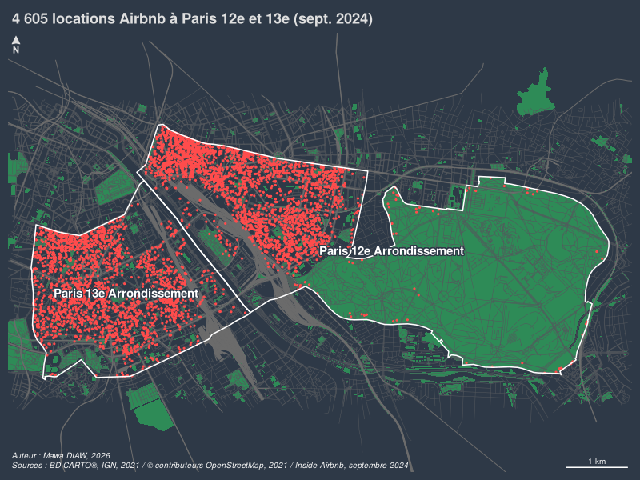
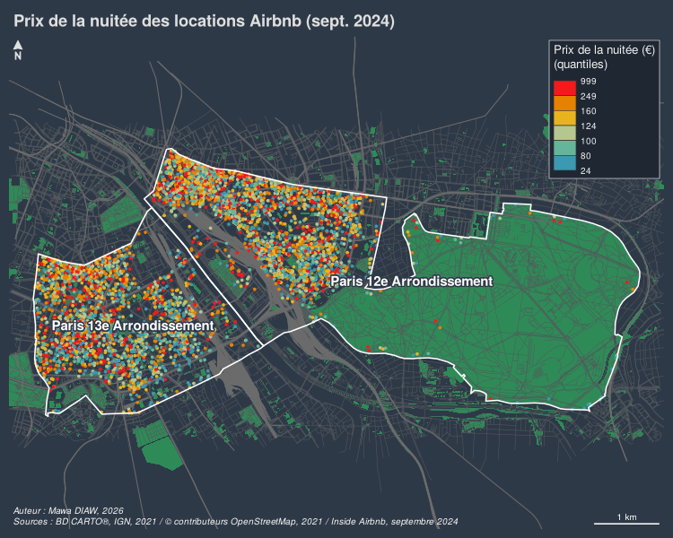
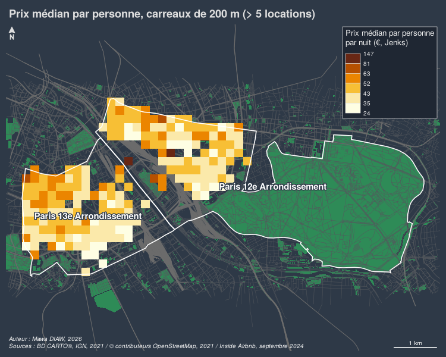
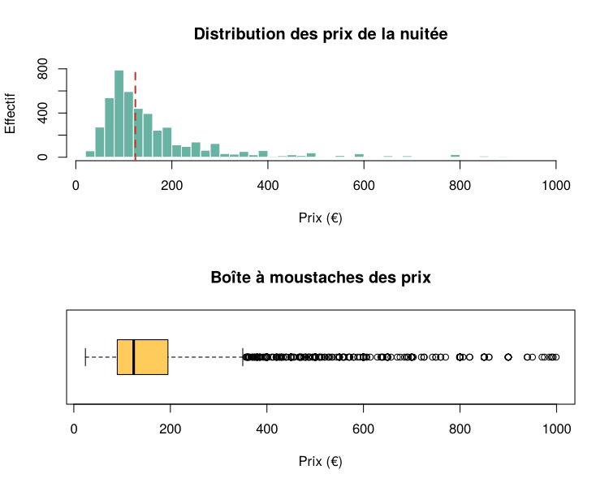

# Prix des locations Airbnb dans les 12e et 13e arrondissements de Paris

Analyse cartographique des locations Airbnb (septembre 2024) dans les 12e et 13e arrondissements de Paris, réalisée avec **R** et **RStudio**.

## Questions traitées

1. **Où se trouvent les locations ?** Carte de situation avec les espaces verts, le réseau viaire et le réseau ferré.
2. **Comment varie le prix de la nuitée ?** Carte des locations colorées selon leur prix, en quantiles, après analyse de la distribution.
3. **Combien coûte une nuit près du MK2 Bibliothèque ?** Prix médian par personne dans un rayon de 600 m.
4. **Où sont les secteurs les plus chers ?** Prix médian par personne sur un carroyage de 200 m, discrétisé selon la méthode de Jenks.

## Résultats

| Locations | Prix de la nuitée |
|---|---|
|  |  |

| Prix médian par carreau de 200 m | Distribution des prix |
|---|---|
|  |  |

## Méthode

- **Projection** : RGF93 / Lambert-93 (EPSG:2154), pour des distances en mètres (zone tampon, carroyage).
- **Prix par personne** : prix de la nuitée divisé par la capacité d'accueil. Les données ne contiennent pas la surface des logements, le prix au m² n'est donc pas calculable.
- **Discrétisations** :
  - Quantiles pour les prix des locations, car leur distribution est très dissymétrique.
  - Jenks pour les carreaux, afin d'isoler les secteurs exceptionnels.
- **Fiabilité** : seuls les carreaux de plus de 5 locations sont cartographiés.

## Données

| Couche | Source |
|---|---|
| Arrondissements | BD CARTO®, IGN, 2021 |
| Espaces verts, routes, voies ferrées | © contributeurs OpenStreetMap, 2021 |
| Locations Airbnb (hors hôtels, prix < 1 000 €) | [Inside Airbnb](https://insideairbnb.com/get-the-data/), septembre 2024 |

## Outils

R · RStudio · `sf` · `mapsf` · `dplyr` · `classInt`

## Reproduire l'analyse

1. Ouvrir `cartographie-r-airbnb-paris-12e-13e.Rproj` dans RStudio.
2. Installer les packages si besoin :
   ```r
   install.packages(c("sf", "mapsf", "dplyr", "classInt"))
   ```
3. Lancer `analyse_airbnb_paris.R`. Les cartes sont enregistrées dans `figures/`, et les résultats chiffrés s'affichent dans la console.

---

Mawa DIAW · Géomaticien / Développeur SIG
