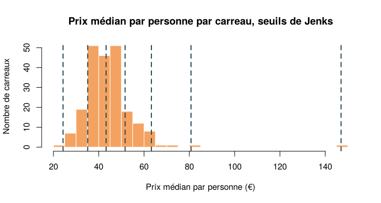

# Prix des locations Airbnb dans les 12e et 13e arrondissements de Paris

Analyse cartographique de **4 605 locations Airbnb** (septembre 2024) dans les 12e et 13e arrondissements de Paris, réalisée avec **R** (`sf`, `mapsf`) : localisation de l'offre, prix de la nuitée, prix autour d'un lieu donné et carroyage des prix à 200 m.


## Chiffres clés

| Indicateur | 12e | 13e | Ensemble |
|---|---:|---:|---:|
| Locations Airbnb | 2 507 | 2 094 | **4 605** |
| Prix médian de la nuitée | 126 € | 120 € | **124 €** |
| Prix médian par personne et par nuit | 44,5 € | 42,9 € | **44 €** |
| Part de logements entiers | 88 % | 87 % | **88 %** |

*Le total inclut 4 locations situées exactement sur une limite d'arrondissement.*

**Autour du MK2 Bibliothèque (rayon de 600 m)** : 220 locations, pour un prix médian de **42 € par personne et par nuit**, soit un niveau proche de la moyenne des deux arrondissements (44 €).

## Ce que montrent les cartes

- **L'offre est dense et quasi exclusivement composée de logements entiers** (88 %). Les chambres privées et partagées restent marginales.
- **Le 12e et le 13e ont des prix très proches** : 1,6 € d'écart sur le prix médian par personne. La différence se joue à l'intérieur des arrondissements, pas entre eux.
- **Le nord est plus cher que le sud**, en particulier dans le 13e : 47 € par personne dans sa moitié nord contre 40 € dans sa moitié sud. L'écart est plus faible dans le 12e (46 € contre 43 €).
- **Les carreaux les plus chers sont rares et isolés** : la moitié des carreaux se situe entre 39 € et 50 € par personne. Le carreau le plus cher (147 €, 6 locations), entre la gare de Lyon et Bercy, relève de quelques annonces haut de gamme plutôt que d'un quartier cher.

## Cartes

### Localisation des locations


### Prix de la nuitée


## Méthode

| Étape | Choix | Pourquoi |
|---|---|---|
| Projection | RGF93 / Lambert-93 (EPSG:2154) | Distances en mètres pour la zone tampon et le carroyage |
| Indicateur de prix | Prix de la nuitée ÷ capacité d'accueil | Compare des logements de tailles différentes ; la surface n'est pas disponible, le prix au m² n'est donc pas calculable |
| Prix des locations | Quantiles, 6 classes | Distribution très dissymétrique (médiane 124 €, maximum 999 €) |
| Prix par carreau | Jenks, 6 classes | Forme des classes homogènes et isole les carreaux exceptionnels |
| Fiabilité | Carreaux de plus de 5 locations | Évite les médianes calculées sur 1 ou 2 annonces |

<details>
<summary>Distributions utilisées pour choisir les discrétisations</summary>

| Prix de la nuitée | Prix médian par carreau, seuils de Jenks |
|---|---|
|  |  |

</details>

## Données

| Couche | Source |
|---|---|
| Arrondissements | BD CARTO®, IGN, 2021 |
| Espaces verts, routes, voies ferrées | © contributeurs OpenStreetMap, 2021 |
| Locations Airbnb (hors hôtels, prix < 1 000 €) | [Inside Airbnb](https://insideairbnb.com/get-the-data/), septembre 2024 |

## Structure du projet

```
├── analyse_airbnb_paris.R                      # script complet (import, cartes, analyses)
├── cartographie-r-airbnb-paris-12e-13e.Rproj   # projet RStudio
├── data/bnb.gpkg                               # données (GeoPackage, 5 couches)
└── figures/                                    # cartes et graphiques produits par le script
```

## Reproduire l'analyse

1. Ouvrir `cartographie-r-airbnb-paris-12e-13e.Rproj` dans RStudio.
2. Installer les packages si besoin :
   ```r
   install.packages(c("sf", "mapsf", "dplyr", "classInt"))
   ```
3. Lancer `analyse_airbnb_paris.R`. Les figures sont enregistrées dans `figures/` et les résultats chiffrés s'affichent dans la console.

Testé avec R 4.3 et `mapsf` 1.3.

## Outils

R · RStudio · `sf` · `mapsf` · `dplyr` · `classInt`

---

**Mawa DIAW** · Géomaticien / Développeur SIG · [Portfolio](https://mawa399.github.io) · [LinkedIn](https://www.linkedin.com/in/mawa-diaw)
